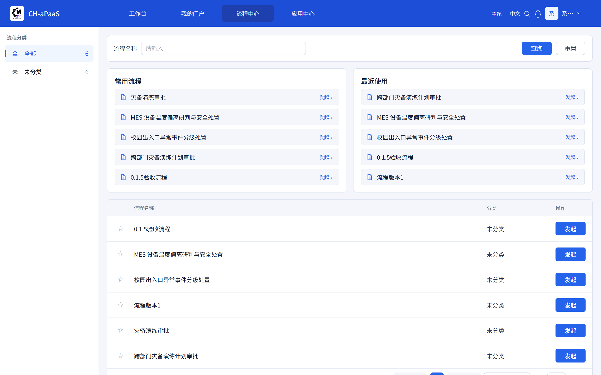
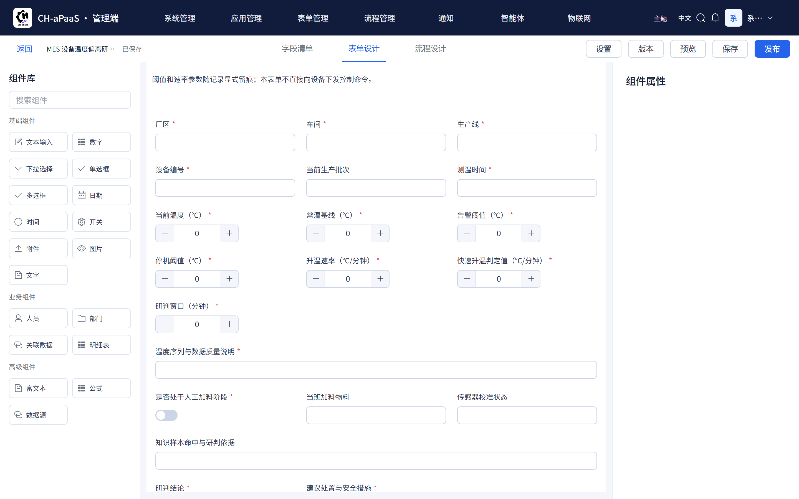
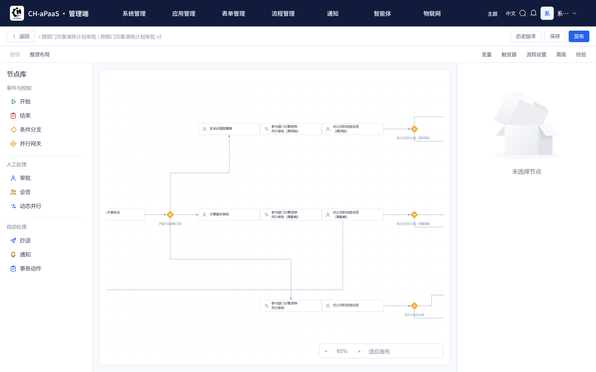
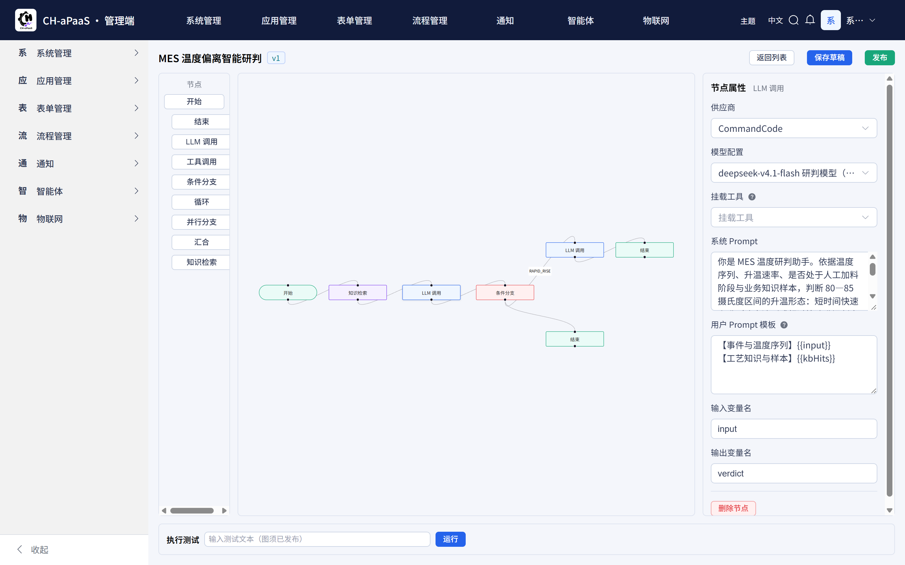
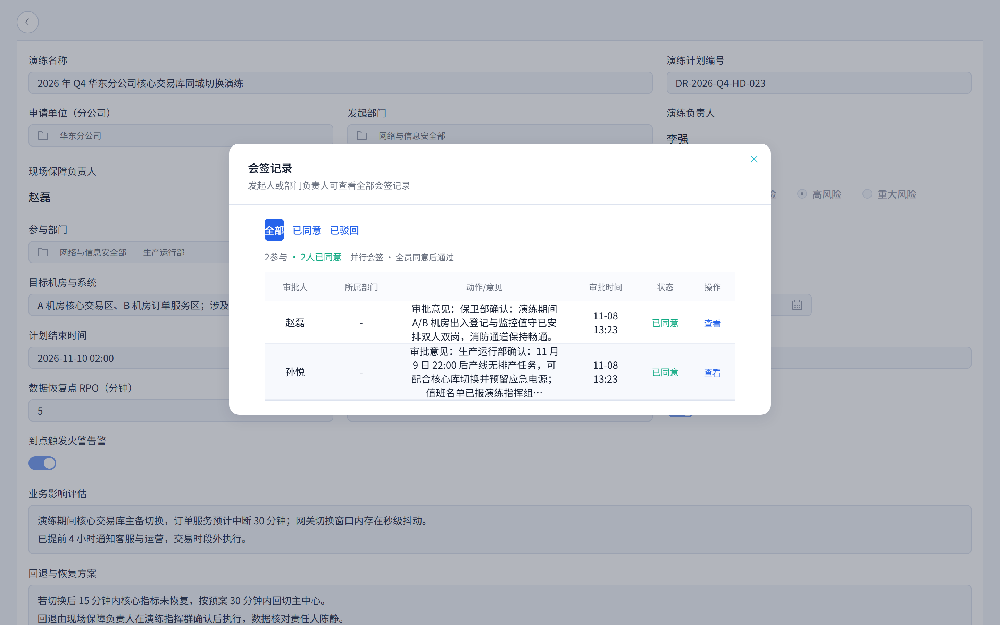
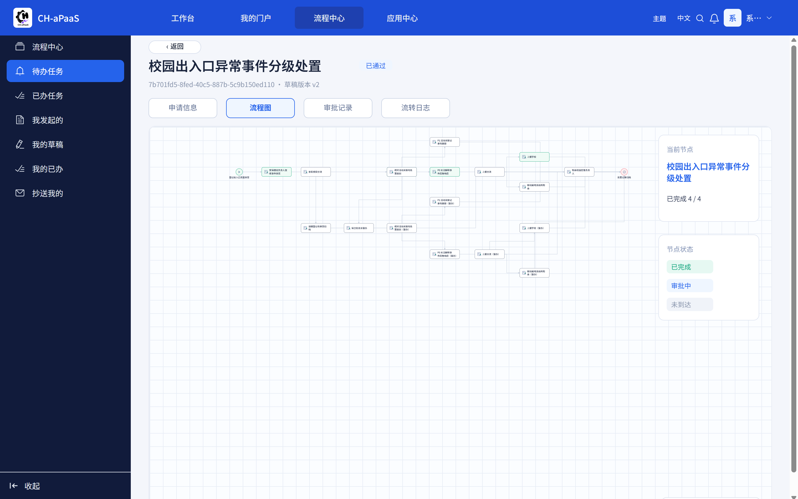
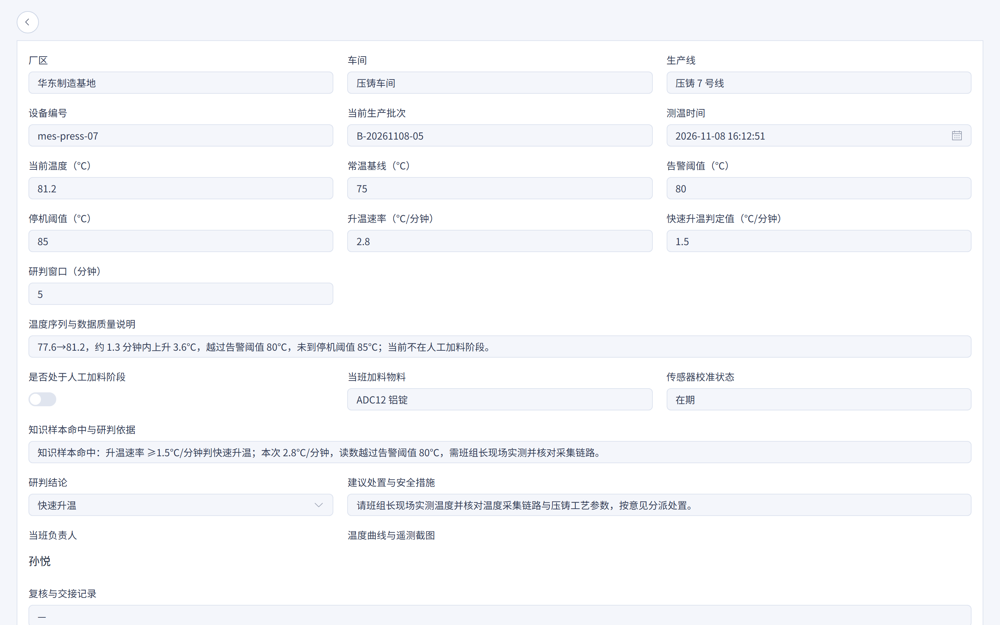
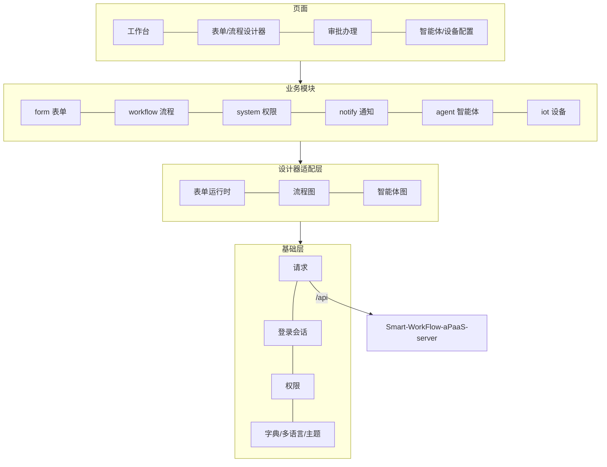

# Smart-WorkFlow-aPaaS-Web


Smart-WorkFlow-aPaaS-Web 是 **CH-aPaaS** 的前端界面（Vue 3 / TypeScript / Element Plus）。CH-aPaaS 是一个可以自己搭建业务应用的低代码平台：把业务做成表单和流程，就能在工作台上发起、审批和跟进。




配套后端：[Smart-WorkFlow-aPaaS-server](https://github.com/Chikaaho/Smart-WorkFlow-aPaaS-server)（当前 0.4.0，本前端 0.3.7）

## 界面预览

| 表单设计器                                          | 流程设计器                                              |
| --------------------------------------------------- | ------------------------------------------------------- |
|  |  |
| 智能体编排                                          | 工作台                                                  |
|    |              |

## 能做什么

- **工作台**：待办、我发起的、抄送我的集中在一处，常用事项可以自己排列。
- **表单设计**：拖拽设计表单，支持附件、图片、默认值和显示联动，设计完即可发布填报。
- **流程设计**：图形化编排审批流，支持会签、条件分支和多人并行审批。
- **审批办理**：待办处理、意见填写、催办提醒；审批过程和意见一目了然。
- **智能体配置**：图形化编排 AI 智能体，配置大模型、工具和知识库，直接在界面上试运行。
- **通知中心**：站内信收件箱，电脑和手机同步；管理员可配置通知规则。

## 三个示例流程

三个完整的示例业务，全部可以在演示环境里走通「填表 → 审批 → 自动执行」的全过程：

| 应急演练                                         | 校园门岗异常                                         | 设备温度监控                                     |
| ------------------------------------------------ | ---------------------------------------------------- | ------------------------------------------------ |
|  |  |  |

- **应急演练**：跨部门演练计划的填报、会签与并行审批界面，审批通过后到点自动执行演练指令。
- **校园门岗异常**：异常人流的分级处置界面，督办、上报、现场处理走不同分支。
- **设备温度监控**：设备异常工单的处置界面，从班组长确认到维修完成再到复产审批。

## 架构



目录划分的完整说明见[工程宪法](docs/governance/engineering-constitution.md)。

## 快速开始

### 环境要求

| 组件    | 版本                                 |
| ------- | ------------------------------------ |
| Node.js | 20+                                  |
| pnpm    | 9+                                   |
| 后端    | Server 0.4.0（见后端仓库的快速开始） |

### 1. 克隆与安装

```bash
git clone https://github.com/Chikaaho/Smart-WorkFlow-aPaaS-Web.git
cd Smart-WorkFlow-aPaaS-Web
NODE_OPTIONS="--max-old-space-size=2048" pnpm install
```

### 2. 配置后端地址

开发模式下页面请求 `/api/**` 会转发到后端，默认 `http://localhost:8080`。后端不在默认地址时，在项目根目录新建 `.env.local`（已被忽略，不会误提交）：

```bash
VITE_PROXY_TARGET=http://127.0.0.1:8080
```

### 3. 启动

```bash
NODE_OPTIONS="--max-old-space-size=2048" pnpm dev
```

- 默认访问 `http://localhost:5173`，端口被占用时用 `pnpm dev --port 51873` 换一个。
- 不启动后端也可以看界面：`pnpm dev:mock`（全部数据为演示数据）。
- 发布构建：`pnpm build`，产物在 `dist/`。

### 4. 首次登录

- 用户名：`admin`
- 口令：`AdminP@ssw0rd`（登录后请修改）

## 版本

当前版本 **0.3.7**，与后端 0.4.0 搭配使用。

历史版本和下载见 [Releases](https://github.com/Chikaaho/Smart-WorkFlow-aPaaS-Web/releases) 与 [CHANGELOG](https://github.com/Chikaaho/Smart-WorkFlow-Agent-Workspace/blob/develop-sw/CHANGELOG.md)。

## 文档

| 文档                                                                                                 | 说明                     |
| ---------------------------------------------------------------------------------------------------- | ------------------------ |
| [工程宪法](docs/governance/engineering-constitution.md)                                              | 目录划分、开发与验证流程 |
| [后端仓库](https://github.com/Chikaaho/Smart-WorkFlow-aPaaS-server)                                  | 服务端部署与配置说明     |
| [CHANGELOG](https://github.com/Chikaaho/Smart-WorkFlow-Agent-Workspace/blob/develop-sw/CHANGELOG.md) | 历史版本说明             |

## 许可证与致谢

本项目以 [MIT License](LICENSE) 开源，可自由使用、修改和分发。

基于 Vue 3、Vite、TypeScript、Element Plus、Pinia、Vue Flow、form-create 等开源组件构建，感谢这些上游项目与贡献者。
