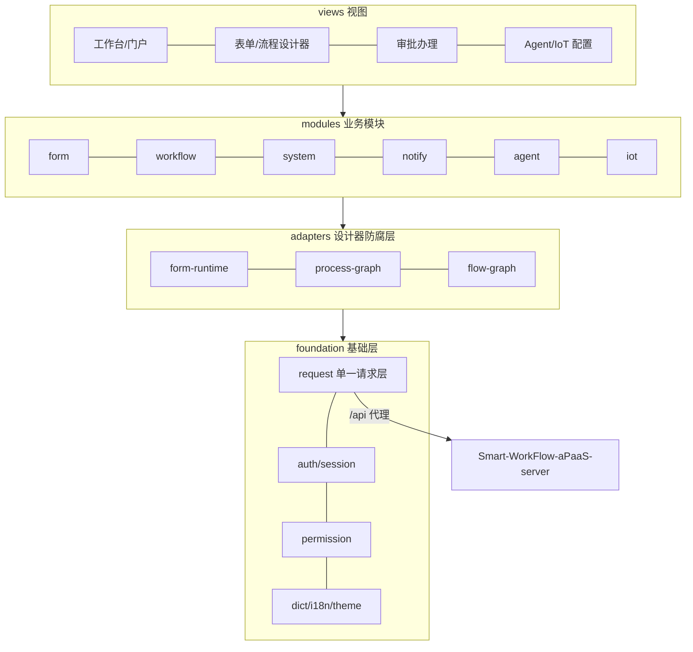

# Smart-WorkFlow-aPaaS-Web


Smart-WorkFlow-aPaaS-Web 是 **CH-aPaaS** 的前端单页应用（Vue 3 / TypeScript），面向普通员工、审批人、业务管理员与平台管理员，提供统一的工作台、业务办理与管理界面。


搭配后端：[Smart-WorkFlow-aPaaS-server](https://github.com/Chikaaho/Smart-WorkFlow-aPaaS-server)（当前 **0.4.0**）

## 界面预览

| 表单设计器                                          | 流程设计器                                              |
| --------------------------------------------------- | ------------------------------------------------------- |
|  |  |

## 核心特性

| 特性           | 说明                                                                                                |
| -------------- | --------------------------------------------------------------------------------------------------- |
| 工作台与门户   | 待办、我发起的、抄送、常用事项个人布局，按用户独立保存                                              |
| 表单设计器     | 可视化设计：多选、附件、图片、说明文字、默认值、条件显示（显隐联动）、只读 JSON 参数中文映射        |
| 流程设计器     | 自研设计器：审批人选择、会签、分支与条件、流程模板中心、监控/干预与基础分析                         |
| 审批与意见展示 | 个人办理四类视图与催办；流转记录"标签：值"意见摘要，审批详情逐项中文展示                            |
| Agent 配置界面 | 模型供应商与模型、图设计器与执行测试（异步生命周期与增量输出）、内部/外部工具、知识库、IoT 事件规则 |
| 主题与体验     | 主题色与暗色适配、中英双语（vue-i18n）、移动端通知 H5，CSP 严格策略                                 |

## 三个示例流程（已完成）

三条示例流程在 UAT 用真实业务数据跑通了完整链路，前端覆盖表单填报、审批办理与流转查看：

| A · 应急演练                                       | B · 值班协同                                             | C · MES 异常研判                                   |
| -------------------------------------------------- | -------------------------------------------------------- | -------------------------------------------------- |
|  |  |  |

- **A · 多部门灾备演练**：跨部门会签与并行审批的表单填报与办理界面，审批意见逐项中文展示。
- **B · 校园出入口流量异常**：事件分级处置的督办/上报/现场处分支流转，告警经由站内信与邮件送达。
- **C · MES 温度智能判断**：研判记录表单与工单流转（班组长确认 → 原因分类 → 校准/维修/工艺调整 → 复产审批）。

## 架构



- **modules** 按业务域组织页面与状态；**adapters** 是设计器防腐层，form-create、流程图等三方 schema 不泄漏进业务模块（ESLint 导入边界强制）。
- **foundation** 收敛横切能力：单一请求层、菜单单一数据源、权限暗态 gating、字典、主题与 i18n。
- 详见[工程宪法](docs/governance/engineering-constitution.md)。

## 快速开始

### 环境要求

| 组件    | 版本         | 说明                         |
| ------- | ------------ | ---------------------------- |
| Node.js | 20+          | CI 使用 Node 20              |
| pnpm    | 9+           | CI 使用 pnpm 9               |
| 后端    | Server 0.4.0 | 见后端仓库 README 的快速开始 |

### 1. 克隆与安装

```bash
git clone https://github.com/Chikaaho/Smart-WorkFlow-aPaaS-Web.git
cd Smart-WorkFlow-aPaaS-Web
NODE_OPTIONS="--max-old-space-size=2048" pnpm install
```

### 2. 配置后端代理

开发代理读取 `VITE_PROXY_TARGET`（默认 `http://localhost:8080`）。后端不在默认地址时，在项目根目录新建 `.env.local`（已被 `.gitignore` 忽略）：

```bash
VITE_PROXY_TARGET=http://127.0.0.1:8080
```

开发模式下页面请求 `/api/**` 由 Vite 代理转发到后端；接口路径前缀由 `.env` 的 `VITE_API_BASE_URL=/api` 定义，一般无需修改。

### 3. 启动开发服务器

```bash
NODE_OPTIONS="--max-old-space-size=2048" pnpm dev
```

默认访问 `http://localhost:5173`（端口被占用时用 `pnpm dev --port 51873` 指定其他端口）。不用本地后端时可用全 mock 模式 `pnpm dev:mock` 看界面。生产构建用 `pnpm build`（产物在 `dist/`），本地预览构建产物用 `pnpm preview`。

### 4. 首次登录

浏览器打开开发地址，用后端种子超管登录：**用户名 `admin`，口令 `AdminP@ssw0rd`**（开发种子口径，见后端仓库迁移脚本 `R__0.1.10_admin_password.sql`；登录后请立即修改）。

## 与后端的搭配

Server 0.4.0 的改动集中在数据库适配（迁移脚本、SQL 种子和启动检查），业务功能与 0.3.2 相同，Web 0.3.6 不需要随版升级。UAT 当前运行 Server 0.4.0 + Web 0.3.6。

## 仓库结构与文档导航

| 路径                                                                                                                           | 说明                                                                               |
| ------------------------------------------------------------------------------------------------------------------------------ | ---------------------------------------------------------------------------------- |
| `src/foundation`                                                                                                               | 请求、认证会话、权限、菜单、字典、主题、i18n、mock                                 |
| `src/modules`                                                                                                                  | form / workflow / system / notify / agent / iot / job / storage / openapi 业务模块 |
| `src/adapters`                                                                                                                 | 设计器防腐层：form-create、流程图、Agent 图目录适配                                |
| [工程宪法](docs/governance/engineering-constitution.md)                                                                        | 前端架构约束、验证门（typecheck/lint/test/build 四连）与开发命令                   |
| [功能清单](https://github.com/Chikaaho/Smart-WorkFlow-Agent-Workspace/blob/develop-sw/Smart-WorkFlow-aPaaS-server/功能清单.md) | 正式功能与版本焦点（工作区仓库）                                                   |

## 版本

当前正式版本 **0.3.6**（2026-11-08，指令参数中文化）：只读 JSON 参数（如设备指令）按字段配置的中文映射显示，「技术参数（JSON 原文）」折叠区仅表单设计权限可见。

| 项目    | 内容                                                                                                            |
| ------- | --------------------------------------------------------------------------------------------------------------- |
| tag     | `0.3.6` → `c3f1d6e`                                                                                             |
| Release | [CH-aPaaS-Web 0.3.6](https://github.com/Chikaaho/Smart-WorkFlow-aPaaS-Web/releases/tag/0.3.6)（id `438126185`） |
| 制品    | `sw-web-dist-0.3.6.zip`，6,197,059 B，sha256 `9470f0c115ece47dfc1c9733cb117df7714c1fd5cfba4c368f880d1d575dd9e3` |

### 历史版本

| 版本线      | 内容                                                                                               |
| ----------- | -------------------------------------------------------------------------------------------------- |
| 0.3.0—0.3.6 | 三示例流程配套与审批意见展示系列返修（0.3.3—0.3.6 为摘要标签、备注回退、列宽与指令参数中文化补丁） |
| 0.2.0—0.2.4 | Agent 界面系列：执行生命周期面板、IoT 规则编辑，以及应用整包导出导入                               |
| 0.1.x       | 工作台、设计器对齐与缺陷修复列车                                                                   |

各版本 tag、Release 与发布说明见仓库 [tags](https://github.com/Chikaaho/Smart-WorkFlow-aPaaS-Web/tags) 与工作区 [CHANGELOG.md](https://github.com/Chikaaho/Smart-WorkFlow-Agent-Workspace/blob/develop-sw/CHANGELOG.md)。

## 许可证与致谢

本仓库为 CH-aPaaS 示例实例的一部分，当前未附带开源许可证；对外使用、分发或再发布前请先与 Owner 确认。

项目基于 Vue 3、Vite、TypeScript、Element Plus、Pinia、Vue Flow、form-create 等开源组件构建。感谢所有上游项目与贡献者。
